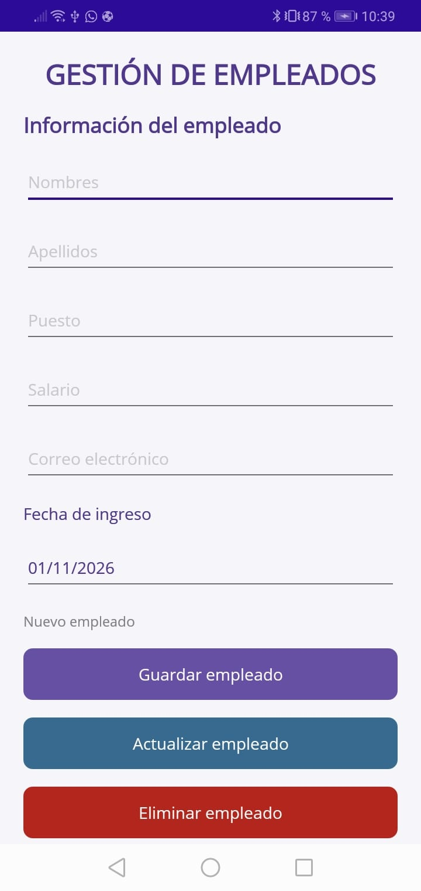
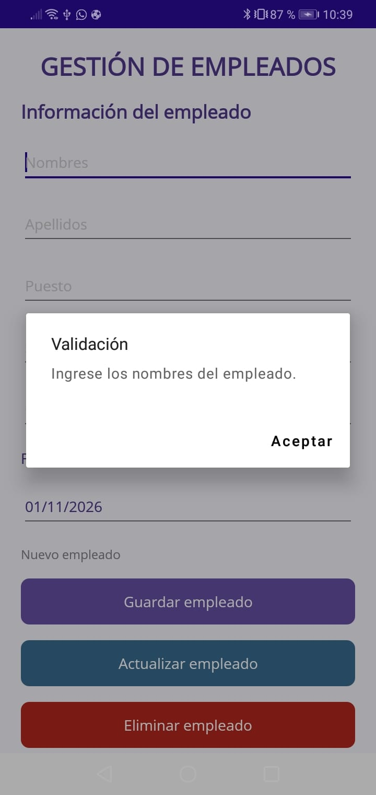
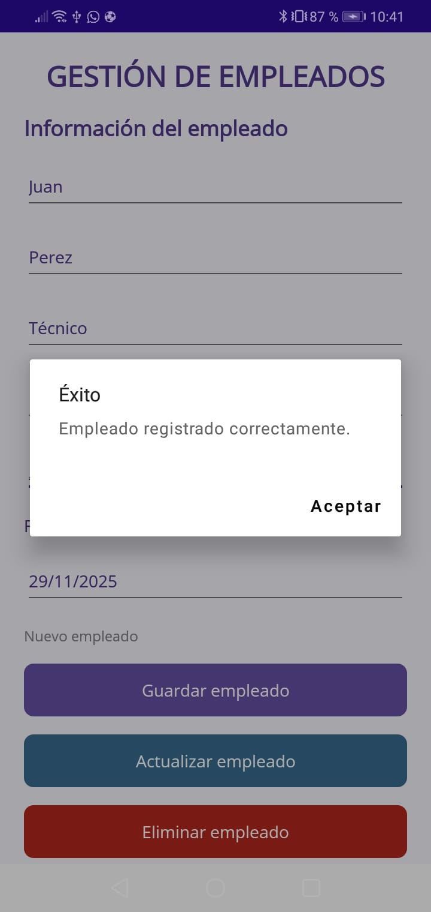

# Registro de Empleados MAUI

Aplicación móvil para la gestión de empleados, desarrollada como proyecto académico utilizando **.NET MAUI, C# y SQLite**.

## Descripción del proyecto

El sistema permite registrar, consultar, actualizar y eliminar información de empleados mediante una interfaz gráfica sencilla e intuitiva.

La información se almacena localmente en una base de datos SQLite, permitiendo administrar los registros desde la aplicación.

## Objetivo

Desarrollar una aplicación móvil que permita gestionar información de empleados mediante operaciones CRUD (Crear, Leer, Actualizar y Eliminar), aplicando validaciones de datos y persistencia mediante SQLite.

## Tecnologías utilizadas

- **Lenguaje de programación:** C#
- **Framework:** .NET MAUI
- **Base de datos:** SQLite
- **Interfaz gráfica:** XAML
- **Entorno de desarrollo:** Visual Studio
- **Control de versiones:** Git y GitHub

## Funcionalidades

### 1. Registro de empleados
Permite ingresar los siguientes datos:

- Nombres.
- Apellidos.
- Puesto.
- Salario.
- Correo electrónico.
- Fecha de ingreso.

### 2. Validación de información

La aplicación verifica que:

- Los campos obligatorios no estén vacíos.
- El salario sea numérico y mayor que cero.
- El correo electrónico tenga un formato válido.

### 3. Listado de empleados

Muestra los empleados registrados mediante un `ListView` personalizado, incluyendo su identificador, nombre, apellidos, puesto y salario.

### 4. Actualización de empleados

Permite seleccionar un empleado, modificar su información y guardar los cambios, conservando su identificador original.

### 5. Eliminación de empleados

Permite eliminar registros seleccionados mediante una confirmación antes de ejecutar la operación.

## Base de datos

La aplicación utiliza SQLite para almacenar la información localmente.

La tabla principal es `Empleados` y contiene los siguientes campos:

| Campo | Tipo de dato | Descripción |
|---|---|---|
| Id | INTEGER | Clave primaria autoincremental |
| Nombres | TEXT | Nombres del empleado |
| Apellidos | TEXT | Apellidos del empleado |
| Puesto | TEXT | Cargo o puesto de trabajo |
| Salario | REAL | Salario del empleado |
| Correo | TEXT | Correo electrónico |
| FechaIngreso | DATETIME | Fecha de ingreso |

La base de datos se inicializa automáticamente al iniciar la aplicación.

## Estructura del proyecto

```text
RegistroEmpleadosExamen1/
│
├── Models/
│   └── Empleado.cs
│
├── Services/
│   └── DatabaseService.cs
│
├── Capturas/
│   ├── 01-Inicio.png
│   ├── 02-Validaciones.png
│   ├── 03-Registro.png
│   ├── 04-Listado.png
│   ├── 05-Actualizacion.png
│   ├── 06-Eliminacion.png
│   └── 07-Confirmacion.png
│
├── MainPage.xaml
├── MainPage.xaml.cs
├── App.xaml
├── App.xaml.cs
└── README.md
```

## Evidencias de funcionamiento

### 1. Pantalla inicial


### 2. Validación de campos


### 3. Registro de empleado


### 4. Listado de empleados


### 5. Actualización de empleado


### 6. Confirmación de eliminación


### 7. Listado después de eliminar


## Autor

**Gil David Martinez**

Examen del primer parcial de la materia de **Programación de Dsipositivos Móviles II**.

---

Repositorio: [RegistroEmpleadosExamen1](https://github.com/gilmartinez557gm-glitch/RegistroEmpleadosExamen1)